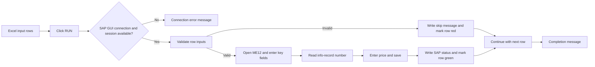

# Excel VBA SAP Purchasing Info Record Updater

An Excel VBA automation tool that reads purchasing data from a worksheet and updates SAP purchasing info records through SAP GUI Scripting.

The application is designed for procurement operations where the same purchasing-info-record maintenance steps must be repeated for multiple supplier, material, purchasing-organization, plant, and price combinations.

> Important: The workbook reviewed for this documentation contains sample business data and identifying metadata. Do not publish that original workbook. Create a sanitized demonstration copy with synthetic data before uploading it to GitHub.

## Project Overview

The application provides an Excel-based input table and a `RUN` button. When the macro runs, it validates each input row, opens SAP transaction `ME12`, enters the supplier/material/purchasing-organization/plant combination, retrieves the purchasing info-record number, updates the price, saves the record, and writes the SAP result back to Excel.

The tool addresses these operational problems:

- Repeated manual entry of the same data in Excel and SAP.
- Time spent navigating SAP screens for each record.
- Inconsistent validation of required fields before SAP entry.
- Difficulty identifying which rows succeeded or failed during a batch.
- Manual copying of info-record numbers and SAP status messages back into a tracking sheet.

## Implemented Features

- One-sheet Excel input and output template.
- Manual execution through a worksheet shape labeled `RUN`.
- Connection to the first active SAP GUI connection and session.
- SAP GUI Scripting automation for transaction `ME12`.
- Row-by-row processing from row 2 through the last non-empty supplier-number row.
- Validation of supplier number, material number, purchasing organization, plant, and price.
- Price formatting to two decimal places before entry into SAP.
- Retrieval of the SAP info-record number into column F.
- Status updates in column H, including SAP status-bar text when available.
- Optional-popup handling during navigation and save confirmation.
- Per-row error handling that marks the failed row and continues with the next row.
- Color-coded output for extracted, successful, processing, and failed states.
- Completion and connection-error message boxes for the operator.

## Workbook Layout

The reviewed workbook contains one visible worksheet named `Sheet1`. Its used range is `A1:H2`; the second row is a sample data row.

| Column | Header | Purpose | Used by the macro |
|---|---|---|---|
| A | Supplier No. | SAP supplier number | Yes |
| B | Description | Human-readable supplier description | No; informational only |
| C | Material Number | SAP material number | Yes |
| D | Purchasing Org. | SAP purchasing organization | Yes |
| E | Plant | SAP plant | Yes |
| F | inforecord number | Info-record number returned by SAP | Written by the macro |
| G | Price | Price to enter in SAP | Yes |
| H | SAP Status | Processing result or SAP status message | Written by the macro |

The `RUN` rectangle is assigned to `SAP_Final_Solution_V2`. There are no formulas, Excel Tables, PivotTables, charts, images, data-validation rules, or additional worksheets in the reviewed file.

## Application Workflow

1. Enter one or more records in columns A, C, D, E, and G. Column B may contain a description for reference.
2. Open SAP GUI, log in to the required system, and leave an active SAP session available.
3. Open the macro-enabled workbook and allow macros only when the file is trusted.
4. Click the `RUN` shape on the worksheet.
5. The macro attaches to the first active SAP GUI connection and session.
6. It changes the output headers to `inforecord number` and `SAP Status`, then identifies the last row using column A.
7. For each row, it clears the previous info-record value and sets the status to `Processing...`.
8. It checks that supplier number, material number, purchasing organization, plant, and price are present and valid.
9. Invalid rows are skipped, marked with a descriptive message in column H, and filled red.
10. Valid rows open SAP transaction `ME12` and enter the supplier, material, purchasing organization, and plant values.
11. The macro reads the info-record number from SAP and writes it to column F as text.
12. It navigates to the purchasing-organization data, handles the optional popup recorded in the SAP workflow, and enters the price.
13. It validates the price in SAP, saves the record, and accepts the expected confirmation dialog when present.
14. The SAP status-bar message is written to column H. If the status bar is empty, the macro uses `Updated successfully`.
15. Successful output cells are filled green. A row-level error is written to column H and filled red, then processing continues.
16. After all rows are attempted, the macro displays a completion message explaining where the info-record numbers and processing results were written.



## VBA Components

| Component | Type | Observed responsibility |
|---|---|---|
| `Module1` | Standard VBA module | Main SAP automation routine and helper procedures |
| `ThisWorkbook` | Workbook document module | Attribute declarations only; no workbook event procedure was found |
| `Sheet1` | Worksheet document module | Attribute declarations only; no worksheet event procedure was found |
| UserForms | None found | No form-based user interface is implemented |

### Procedures in `Module1`

- `SAP_Final_Solution_V2`: Main public procedure that validates Excel input, drives SAP, writes results, and reports completion.
- `WaitForSAPV2`: Waits for the SAP session to stop being busy, with a 30-second timeout.
- `SAPWindowExistsV2`: Checks whether an SAP window exists without raising an error.
- `SAPControlExistsV2`: Checks whether a specific SAP control exists.
- `GetSAPStatusTextV2`: Reads the SAP status-bar text.
- `GetSAPStatusTypeV2`: Reads the SAP status-bar message type.
- `MarkSAPRowErrorV2`: Writes a row error to column H and applies the red error fill.

## Technical Details

### Languages and technologies

- Visual Basic for Applications (VBA).
- Microsoft Excel macro-enabled workbook format (`.xlsm`).
- SAP GUI Scripting through late-bound COM objects.
- SAP transaction `ME12` for purchasing info-record maintenance.

### SAP GUI automation points

The macro uses SAP GUI Scripting calls including:

- `GetObject("SAPGUI")` and `GetScriptingEngine` to obtain the SAP scripting object.
- `Session.FindById(...)` to address SAP controls.
- `/NME12` to open the transaction.
- `EINA-LIFNR`, `EINA-MATNR`, `EINE-EKORG`, and `EINE-WERKS` for the record key.
- `EINA-INFNR` to read the info-record number.
- `KONP-KBETR[2,0]` to enter the price.
- `SendVKey 0` for validation and `SendVKey 11` for save.
- `wnd[0]/sbar` to read the SAP status-bar text and message type.

The SAP objects are declared as generic `Object` variables. No explicit SAP GUI type-library reference was found in the VBA source. The project metadata does include standard Office and `stdole` references.

### Error handling

- A missing SAP connection or session stops the overall run and displays a connection error message.
- Missing or invalid row inputs are skipped before SAP navigation.
- Errors raised while processing a valid row are written to column H and do not stop later rows.
- SAP waits use `Session.Busy`, `DoEvents`, and a 30-second timeout.
- The macro does not create a separate log file or rollback a SAP change after a later step fails.

## Requirements

- Windows desktop Excel with VBA and macro support.
- SAP GUI for Windows installed and available to Excel.
- An active SAP GUI connection and logged-in SAP session.
- SAP GUI Scripting enabled on the client and SAP server.
- Authorization to access transaction `ME12` and change the relevant purchasing info records.
- A workbook whose SAP screen layout matches the control IDs used by the macro.

The macro does not log in to SAP, create a connection, select among multiple SAP sessions, import data from another system, or request additional SAP authorization.

## Installation and Setup

1. Download or clone the repository.
2. Use a sanitized `.xlsm` demo workbook for public distribution. Keep the original business workbook outside the repository.
3. Open the workbook in desktop Excel. If Excel shows Protected View, leave it protected unless the file is trusted and you need to operate the demo.
4. Open SAP GUI, log in to the intended system, and keep the target session active.
5. Confirm that SAP GUI Scripting is enabled and that the user is authorized for the intended records.
6. Populate the input columns using the layout above. Use synthetic values when testing the public demo.
7. Run one test record in a non-production environment before processing a larger batch.
8. Click `RUN` and review columns F and H for the info-record number and SAP result.

Do not lower Excel macro-security settings globally. Use a trusted, controlled location or an approved per-file workflow consistent with your organization's security policy.

## Usage Example

Use synthetic values for demonstrations:

| Supplier No. | Description | Material Number | Purchasing Org. | Plant | Price |
|---:|---|---|---:|---:|---:|
| 100000 | Demo Supplier | DEMO-MAT-001 | 1000 | 1000 | 12.50 |

After the macro runs, SAP returns the info-record number in column F and the SAP status or error message in column H. The real SAP response depends on the connected system, authorizations, master data, and screen configuration.

## Business Benefits

- Reduces repetitive Excel-to-SAP data entry.
- Provides a consistent validation step before SAP navigation.
- Processes multiple rows from a single worksheet action.
- Returns the SAP-generated info-record number directly to the working file.
- Makes successes and failures visible at row level.
- Continues processing after an individual row error.
- Helps procurement users spend less time on repetitive transaction navigation.

The workbook does not include measured time-savings or error-rate metrics. Any quantified business impact should be added only after comparing a controlled manual baseline with production-approved usage.

## Current Scope and Limitations

The following behavior is implemented in the reviewed workbook:

- One worksheet and one manual `RUN` action.
- The first active SAP connection and first session are used.
- The last row is determined from column A. Rows after the last non-empty supplier number are not processed.
- Blank supplier-number rows inside the detected range are skipped as row errors.
- Column B is not sent to SAP.
- Price is the only commercial value updated. Currency, price unit, validity dates, condition type, and other purchasing fields are not handled by this macro.
- SAP control IDs are hard-coded and may require maintenance after SAP GUI layout or transaction changes.
- SAP changes are not rolled back if a later step fails.
- Statuses are stored in the workbook only. No external audit log or run history is generated.
- The workbook does not provide a user form, configuration screen, session selector, retry queue, or automatic scheduling.

## Suggested Future Improvements

These are recommendations only. They are not implemented in the reviewed workbook.

- Add a preflight check for the active SAP connection, scripting availability, transaction access, and required columns.
- Add a controlled SAP-session selector instead of always using the first connection and session.
- Move SAP control IDs, timeout values, and transaction settings into a documented configuration area.
- Add a run ID, timestamp, operator, and append-only audit log.
- Add duplicate checks, stronger data-type validation, and explicit handling for gaps in input rows.
- Add configurable currency, price-unit, validity-date, and condition-field support when the business process requires it.
- Add retry handling for recoverable SAP timeouts and a reconciliation view for records that need manual review.
- Add a controlled UserForm for guided input and clearer operator feedback.
- Add automated test cases using a mock SAP interface or a non-production SAP environment.
- Add documentation for the exact SAP GUI version, transaction variant, and client/server scripting configuration.

## Recommended Repository Structure

```text
excel-vba-sap-info-record-updater/
├── README.md
├── LICENSE
├── workbook/
│   └── INFORECORD_UPDATION_demo.xlsm
├── src/
│   ├── Module1.bas
│   ├── Sheet1.cls
│   └── ThisWorkbook.cls
├── data/
│   └── sample_input.csv
├── screenshots/
│   ├── 01-input-template.png
│   ├── 02-run-button.png
│   ├── 03-processing-status.png
│   └── 04-success-and-error-results.png
└── docs/
    ├── workflow.md
    └── sap-gui-scripting-prerequisites.md
```

### Files suitable for GitHub

- `README.md` and workflow documentation.
- Exported VBA source modules, if company policy permits publishing the code.
- A sanitized `.xlsm` demonstration workbook with synthetic data.
- Synthetic sample input data and sanitized screenshots.
- A license selected by the project owner.

### Files to keep private or remove before publishing

- The original workbook containing live or company-specific supplier, material, plant, purchasing-organization, info-record, price, and status data.
- SAP system names, hostnames, client numbers, usernames, screenshots, or exported logs.
- Workbook metadata such as author names, company names, SharePoint paths, document IDs, and revision identifiers.
- Any credentials, tokens, passwords, or connection strings. No plaintext SAP credential was found in the extracted VBA source, but the workbook contains VBA project-protection metadata and should still be treated as internal until sanitized.
- Unsanitized `vbaProject.bin` or an unreviewed copy of the original `.xlsm`.

## Suggested Screenshots

Use synthetic or redacted data in every screenshot:

1. The input worksheet showing the required columns and a few demo rows.
2. The `RUN` button positioned beside the input table.
3. A processing state showing `Processing...` in column H.
4. A completed run showing a returned info-record number, green success cells, and a red validation error on a separate demo row.
5. A sanitized SAP `ME12` screen showing the navigation stage without system identifiers or business data.
6. A simple workflow image or Mermaid diagram explaining Excel input, SAP update, and Excel output.

## Resume and Portfolio Description

Developed an Excel VBA automation that batch-updates SAP purchasing info records through SAP GUI Scripting. Implemented structured input validation, SAP transaction navigation, price updates, status capture, per-row error handling, and color-coded results to reduce repetitive procurement-maintenance work and improve processing visibility.

## License and Disclaimer

Select a license that matches the ownership and publication rights for the VBA source and workbook. This project is an automation example and must be tested with synthetic data or an approved non-production SAP environment before use against live records.
